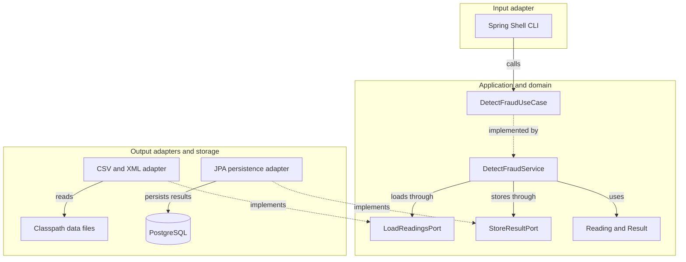
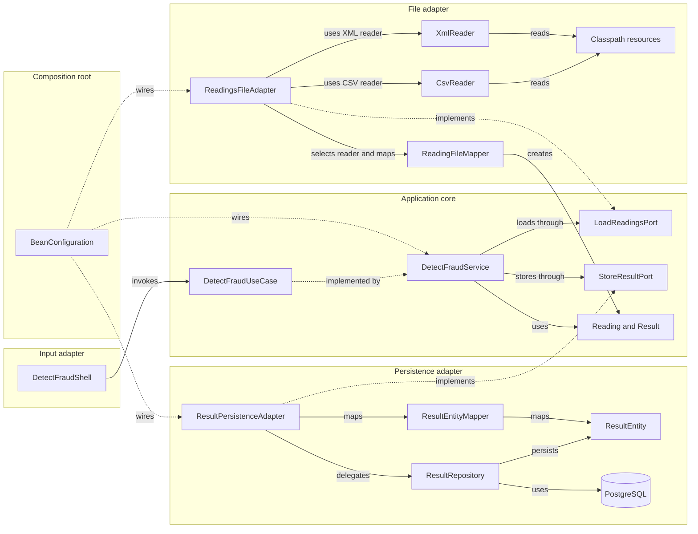

# Architecture Diagram

The application uses a hexagonal structure: the Spring Shell CLI enters through an application use case, while file loading and PostgreSQL persistence are accessed through outbound ports.

## Application Architecture

<!-- mermaid-checked: no \n, no em-dash/en-dash, no {} in labels, subgraphs are id["label"], arrows are -->|"label"|, all subgraphs closed by end, ids unique -->

### Technology Stack Summary

| Layer | Technology | Version | Purpose |
|---|---|---|---|
| Runtime | Java | 25 | Application runtime |
| Application | Spring Boot | 4.1.2 | Dependency injection and application startup |
| CLI | Spring Shell | 4.0.3 | Interactive console commands |
| File input | OpenCSV and Jackson XML | 5.12.0 and 2.22.4 | Reading CSV and XML resources |
| Persistence | Spring Data JPA and Hibernate | Spring Boot managed | Store detection results |
| Database | PostgreSQL | 17 in Docker Compose | Persistent result storage |
| Mapping | MapStruct | 1.6.3 | Map file and persistence models |
| Build | Maven Wrapper | 3.8.6 | Build and test |

### Data Storage & External Services

Reading files are loaded from the fixed classpath directory `data`, backed by `src/main/resources/data`. Detection results are persisted in PostgreSQL through Spring Data JPA. The application does not expose a web API or integrate with other external services.

### Key Architectural Decisions

- The CLI is an inbound adapter; file loading and persistence are outbound ports implemented by adapters.
- The domain uses `YearMonth`; persistence stores periods as the first day of the month.
- Input accepts plain `.csv` and `.xml` filenames from `src/main/resources/data`, not filesystem paths.

## Component Relationships

<!-- mermaid-checked: no \n, no em-dash/en-dash, no {} in labels, subgraphs are id["label"], arrows are -->|"label"|, all subgraphs closed by end, ids unique -->

### Component Inventory

| Component | Layer | Type | Responsibility |
|---|---|---|---|
| `DetectFraudShell` | Input adapter | CLI component | Accept scan commands and display results |
| `DetectFraudUseCase` | Application | Inbound interface | Define the fraud-detection operation |
| `DetectFraudService` | Application | Use case implementation | Calculate annual client means and identify suspicious readings |
| `LoadReadingsPort` | Application | Outbound interface | Request readings from an input source |
| `StoreResultPort` | Application | Outbound interface | Persist detection results |
| `Reading` and `Result` | Domain | Records | Represent input readings and detected results |
| `ReadingsFileAdapter` | File adapter | Port implementation | Validate file names and select a reader |
| `CsvReader` and `XmlReader` | File adapter | Readers | Parse classpath CSV and XML resources |
| `ReadingFileMapper` | File adapter | MapStruct mapper | Convert file models into domain readings |
| `ResultPersistenceAdapter` | Persistence adapter | Port implementation | Convert and persist domain results |
| `ResultRepository` | Persistence adapter | Spring Data repository | Store result entities |
| `ResultEntityMapper` | Persistence adapter | MapStruct mapper | Convert between domain and JPA models |
| `ResultEntity` | Persistence adapter | JPA entity | Represent a stored detection result |
| `BeanConfiguration` | Composition root | Spring configuration | Wire use case and adapter implementations |
