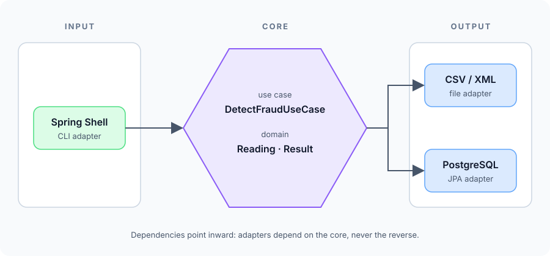

# Fraud Detection

A Spring Boot console application that detects unusually high electricity readings. It reads CSV and XML files through Spring Shell and stores detection results in PostgreSQL.

## Architecture

The core depends on inbound use cases and outbound ports; the CLI, file readers, and persistence adapter connect those ports to external concerns.



## Detection rule

A reading is suspicious when it is more than 50% above the mean for the same client and calendar year. The reading being evaluated is included in that mean. This version detects unusually high readings only.

## Requirements

- Java 25
- Docker Compose (for PostgreSQL and integration tests)

## Run

Start PostgreSQL, then launch the interactive shell:

```bash
docker compose up -d postgres
./mvnw spring-boot:run
```

Alternatively, run everything in Docker (the shell attaches to your terminal):

```bash
docker compose run --rm --build fraud-detection
```

Database settings can be supplied with `DB_URL`, `DB_USERNAME`, and `DB_PASSWORD`. Defaults are configured in `application.properties`.

## Usage

Bundled sample files are available under `src/main/resources/data`. Provide a file name—not a path—with a `.csv` or `.xml` extension:

```text
shell:>scan --fileName 2016-readings.xml

| Client              | Period             | Suspicious         | Mean     |
 ---------------------------------------------------------------------------
| 583ef6329d89b       | 2016-09            | 162078             | 63849.75 |
```

Run `info` for application details and `help` for the available commands.

## Tests

```bash
./mvnw clean verify
```

Integration tests use PostgreSQL Testcontainers and are skipped when Docker is unavailable.
